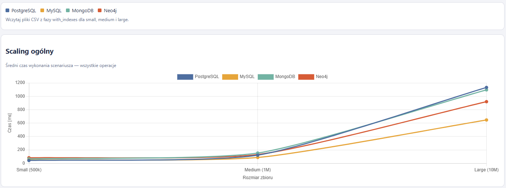
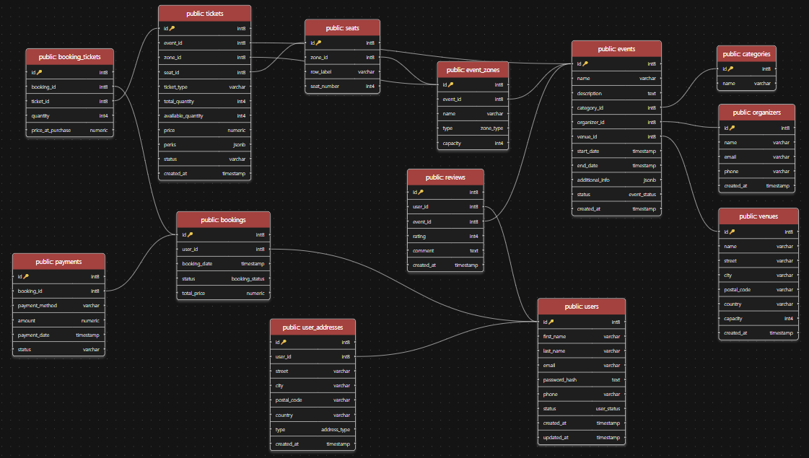
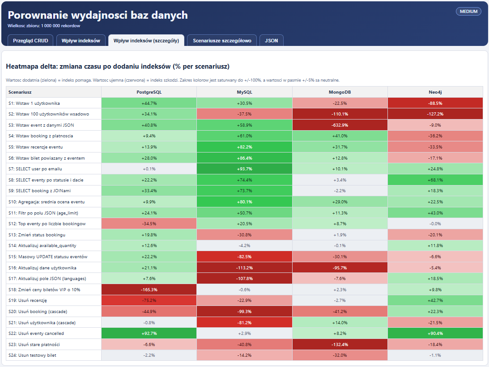

# SQL vs NoSQL Performance Benchmark
### PostgreSQL · MySQL · MongoDB · Neo4j on an event ticketing system

Project from the **Advanced Database Technologies** course (*Zaawansowane Technologie Baz Danych*), Cracow University of Technology.

The same event ticketing domain is modelled in **two relational, one document and one graph database**. Each database runs in Docker, is loaded with **500k, 1M and 10M records**, and is tested on **24 CRUD scenarios** (3 runs each), **with and without indexes**. Query plans are analysed with `EXPLAIN`.

**Research hypothesis (H2):** performance differences between database engines grow as data volume grows. ✅ *Confirmed, with the exception of DELETE operations.*



## Tech stack
Python · PostgreSQL 16 · MySQL 8 · MongoDB 7 · Neo4j 5 (Cypher) · Docker Compose · psycopg2 · mysql-connector-python · PyMongo · neo4j driver · pandas · Chart.js (HTML dashboard)

## Data model
One domain (users, events, venues, organizers, categories, zones, seats, tickets, bookings, payments, reviews) mapped to each engine's own model:

| Engine | Model |
|--------|-------|
| **PostgreSQL / MySQL** | 13 normalised tables, foreign keys with `ON DELETE CASCADE / SET NULL`, ENUM types, JSON columns (`JSONB` in PostgreSQL) |
| **MongoDB** | partly denormalised documents: `events` embed organizer, venue, zones and tickets; `bookings` embed items and payment; `reviews` use references |
| **Neo4j** | nodes `User, Event, Booking, Ticket, Payment, Venue, Organizer, Category, Zone` and relationships such as `MADE_BOOKING`, `CONTAINS`, `FOR_EVENT`, `HELD_AT`, `REVIEWED`, `ATTENDED`. JSON fields are flattened into node properties because Neo4j has no nested properties |

<details>
<summary>Relational schema</summary>


</details>

Data is generated synthetically (streamed JSON, `seed=42`) in three sizes: **small 500k**, **medium 1M** and **large 10M** records in total.

## Test scenarios (24)
| Operation | Scenarios |
|-----------|-----------|
| **CREATE** (S1–S6) | single and batch (100) user insert, event with JSON data, booking with ticket and payment, review, ticket linked to event |
| **READ** (S7–S12) | user by email, events by status and date range, booking with JOINs, average rating aggregation, filter on JSON field `age_limit`, top events by number of bookings |
| **UPDATE** (S13–S18) | booking status, ticket availability, bulk status update of 100 events, user data, JSON array `languages`, VIP ticket prices +10% |
| **DELETE** (S19–S24) | review, booking (cascade), user (cascade), cancelled events, old payments, test ticket |

Each scenario runs 3 times and the mean time is reported. The benchmark runs in two phases (`without_indexes` and `with_indexes`). Results go to CSV and to an interactive HTML dashboard (Chart.js).

## Key results

**Mean scenario time (with indexes)**

| Engine | Small (500k) | Medium (1M) | Large (10M) | Growth large/small |
|--------|-------------:|------------:|------------:|-------------------:|
| PostgreSQL | 42.4 ms | 121.0 ms | 1,132.0 ms | ×26.7 |
| MySQL | 48.7 ms | 86.8 ms | 646.6 ms | ×13.3 |
| MongoDB | 65.2 ms | 152.9 ms | 1,095.9 ms | ×16.8 |
| Neo4j | 82.2 ms | 130.5 ms | 919.6 ms | ×11.2 |

**Main findings**
- **Point lookups on indexed keys scale well in every engine.** For example, reading a user by email in MongoDB took 3.4, 5.5 and 5.1 ms for the three sizes.
- **Aggregations, joins and bulk updates diverge with size.** The gap between the fastest and slowest engine for the "top events" ranking (S12) grew from 165 ms to 917 ms, and for the bulk VIP price update (S18) from 0.9 s to 11.3 s.
- **MongoDB won the most scenarios** (13 of 24 at 10M). It was best at DELETE and at multi-entity inserts, because inserting one nested document is cheaper than writing to several tables with FK checks.
- **PostgreSQL had the best READ average at every size** and was best at filtering and aggregation (S10 at 10M: 309 ms vs 3,067 ms in Neo4j).
- **MySQL had the lowest total time at 10M** (15.5 s vs 22.1–27.2 s for the others), mainly thanks to the fastest bulk UPDATE (S18).
- **Neo4j was the slowest on aggregations** (S10, S12) and the least predictable, because of JVM warm-up on the first run.
- **Indexes are not always a win.** They clearly sped up READs (MongoDB S8 +77%, PostgreSQL DELETE S22 +99.7% at 10M) but slowed down inserts and bulk updates. In some cases the planner chose a worse plan, e.g. PostgreSQL ignores the GIN index on `age_limit` because about 33% of rows match the filter.



### Interactive dashboards
| Dataset | Dashboard |
|---------|-----------|
| Scaling across sizes (hypothesis H2) | [dashboard_h2](https://karolinakokoszka.github.io/events-db-comparison/tests/results/dashboard_h2.html) |
| Small (500k) | [dashboard_small](https://karolinakokoszka.github.io/events-db-comparison/tests/results/dashboard_small.html) |
| Medium (1M) | [dashboard_medium](https://karolinakokoszka.github.io/events-db-comparison/tests/results/dashboard_medium.html) |
| Large (10M) | [dashboard_large](https://karolinakokoszka.github.io/events-db-comparison/tests/results/dashboard_large.html) |
| Large (10M), without the S18 outlier | [dashboard_large_without_S18](https://karolinakokoszka.github.io/events-db-comparison/tests/results/dashboard_large_without_S18.html) |

Raw measurements (3 runs per scenario, with and without indexes, for each size) are in [`tests/results/`](tests/results) as CSV files.

The full report (in Polish, 38 pages) includes the theory part (reliability, security, scalability, business use cases), per-size analysis, outliers and query plans: [`report.pdf`](report.pdf)

## Project structure
```
generator/          data generator + importers for each database (run_all.py)
db/                 schemas: postgres/init.sql, mysql/init.sql, mongo/*.js, neo4j/init.cypher
tests/              CRUD implementations per engine, scenarios.py, run_tests.py, run_explain.py
tests/results/      benchmark results (CSV) and HTML dashboards
images/             charts used in this README
docker-compose.yml  all four databases in containers
```

## How to run
Requirements: Docker, Python 3.11+

Step-by-step instructions for Windows / PowerShell (in Polish): [`INSTRUKCJA_URUCHOMIENIA.txt`](INSTRUKCJA_URUCHOMIENIA.txt)

> Passwords in `docker-compose.yml` are local development defaults only.
